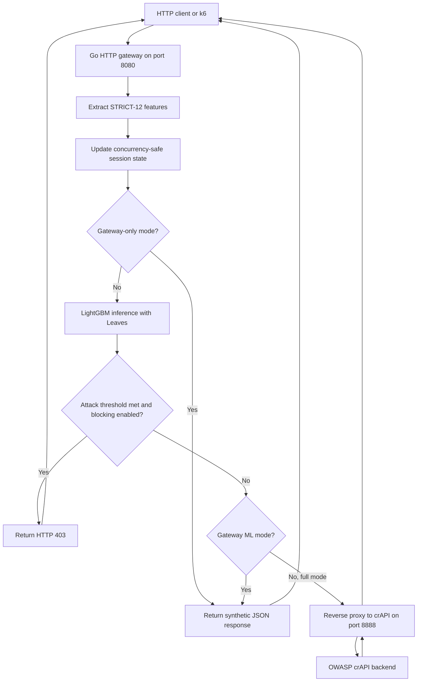

# API Shield Gateway

**Concurrency-aware, in-process machine learning for real-time HTTP API threat detection in Go.**


> **Research prototype · Controlled environment.** Built as part of an MSc cybersecurity thesis. This is an experimental API-security gateway, **not a replacement for server-side authorization checks** or a production-hardened WAF.

## Overview

API Shield Gateway intercepts incoming HTTP requests, derives **12 request-level and session-level features**, evaluates a trained **four-class LightGBM** model directly inside the Go process via [Leaves](https://github.com/dmitryikh/leaves), and decides whether to forward or block each request.

The model classifies:

| Label | Class | Meaning |
|:---:|---|---|
| `0` | **BENIGN** | Normal API activity |
| `1` | **BOLA** | Broken Object Level Authorization patterns |
| `2` | **BFLA** | Broken Function Level Authorization patterns |
| `3` | **SQLi** | SQL injection patterns |

This repository focuses on the **Go gateway and in-process model serving**. The thesis dataset-generation and offline ML-training pipelines are distinct parts of the research workflow and are intended to be documented in companion repositories.

## Architecture



**Request path:** HTTP interception → feature extraction → state update → in-process classification → enforcement decision → synthetic benchmark response or backend forwarding. In `gateway_only` mode, ML inference is skipped and a benchmark response is returned.

### Why Go + Leaves?

- **In-process inference:** no separate prediction microservice is needed on the gateway's critical path.
- **Concurrent handling:** Go's `net/http` request handling and mutex-protected per-session counters support parallel requests.
- **Behavioral detection:** session access patterns and payload characteristics supplement basic request metadata.
- **Measured trade-offs:** separate modes isolate gateway overhead, ML-serving overhead, and backend processing.

## Research results

The **original thesis evaluation**, on a controlled local testbed, reported:

| Model metric | Held-out test result |
|---|---:|
| Multiclass accuracy | **98.81%** |
| Macro F1-score | **97.17%** |

**Original thesis: Gateway + ML benchmark**

| Concurrent virtual users | Throughput (requests/s) | Mean latency (ms) | P95 (ms) | P99 (ms) |
|---:|---:|---:|---:|---:|
| 10 | 9,985.56 | 0.64 | 1.74 | 5.02 |
| 50 | 8,516.34 | 5.12 | 11.74 | 20.73 |
| 100 | 7,953.20 | 11.20 | 23.20 | 38.41 |
| 200 | 8,200.77 | 21.29 | 42.51 | 68.95 |

**Interpretation:** These are measurements from the **original thesis implementation and local test conditions**, not guaranteed results on other machines. After the thesis, the Go online feature definitions were aligned more closely with the offline Python pipeline; subsequent benchmark runs use a **revised implementation** and must not be represented as exact reproductions of this table. The backend, gateway and load generator can compete for resources when run on the same host.

The reported ML classification metrics come from the **offline held-out test set**. A single gateway request or the built-in model-only benchmark endpoint does **not** establish end-to-end online accuracy or exhaustive Python–Go parity.

### Updated Gateway + ML Performance Results (November 2026)

Following additional code refinements, optimizations, and bug fixes, the Go gateway was benchmarked again under concurrent workloads. The updated implementation demonstrated higher throughput and lower latency compared with the original thesis measurements under the local test conditions.

| Concurrent Users | Throughput (req/s) | Average Latency (ms) | P95 (ms) | P99 (ms) |
|---|---:|---:|---:|---:|
| 10 | 15,362.21 | 0.427 | 1.05 | 1.62 |
| 50 | 15,222.54 | 2.99 | 7.67 | 10.61 |
| 100 | 14,775.75 | 6.33 | 16.14 | 23.36 |
| 200 | 14,884.17 | 12.69 | 31.44 | 46.80 |

These results represent post-thesis performance measurements of the refined implementation and do not replace the original research findings.

## Final STRICT-12 features

The feature vector is ordered exactly as expected by the exported model:

| # | Feature | Description |
|---:|---|---|
| 1 | `log_req_size` | Log-transformed request-body size |
| 2 | `is_read_method` | GET indicator |
| 3 | `is_write_method` | POST/PUT/PATCH/DELETE indicator |
| 4 | `endpoint_depth` | API path depth, capped at 10 |
| 5 | `endpoint_has_id_placeholder` | Whether a normalized path includes an ID placeholder |
| 6 | `payload_present` | Whether the request body is nonempty |
| 7 | `log_payload_length` | Log-transformed payload length |
| 8 | `payload_shape_score` | Payload quote/operator/symbol and entropy score |
| 9 | `payload_non_alnum_ratio` | Proportion of non-alphanumeric, non-space characters |
| 10 | `repeated_endpoint_access_count_so_far` | Per-session accesses to the normalized endpoint |
| 11 | `resource_probe_rate_so_far` | Per-endpoint distinct-target / access ratio |
| 12 | `target_change_rate_so_far` | Cumulative target changes / session requests |

These are **model inputs, not twelve independent attack rules**. LightGBM learns the internal tree split thresholds. Separately, the gateway uses configurable attack-class blocking confidence thresholds (default `0.50`).

## Repository structure

```text
api-shield-gateway/
├── main.go              # Startup and route registration
├── config.go            # Defaults, environment settings, helpers
├── gateway.go           # Request lifecycle and enforcement
├── features.go          # STRICT-12 feature extraction
├── session.go           # Concurrency-safe session state
├── inference.go         # Leaves loading, inference, thresholds
├── proxy.go             # Backend HTTP forwarding
├── benchmark.go         # Isolated gateway/model benchmark routes
├── helpers.go           # Shared conversions
├── features_test.go     # Initial regression tests
├── api_threat_model_lgbm_antioverfit_strict_12_v3.txt
├── go.mod
├── go.sum
├── .gitignore
└── README.md
```

## Quick start (Windows PowerShell)

### Prerequisites

- [Go](https://go.dev/dl/) installed (tested locally with `go1.26.2 windows/amd64`).
- The Leaves-compatible model text file in the repository root; its default name is `api_threat_model_lgbm_antioverfit_strict_12_v3.txt`.
- **OWASP crAPI** is optional for the gateway-only and gateway+ML benchmarks, but is required for `full` proxy testing. See the [official crAPI project](https://owasp.org/www-project-crapi/).

### 1. Get the source and validate it

```powershell
# After the GitHub repository is published:
git clone https://github.com/samuelataklti/api-shield-gateway.git
cd .\api-shield-gateway

go mod download
go test ./...
go build -o "$env:TEMP\api-shield-verify.exe" .
```

> **Important:** Run `go run .` or `go build .`, **not** `go run main.go`: the application is intentionally split across multiple Go files in the same package.

### 2. Start without a crAPI backend (Gateway + ML mode)

```powershell
$env:BENCH_MODE="gateway_ml"
$env:BLOCKING_ENABLED="0"
$env:DEBUG_LOGS="0"
$env:BENCHMARK_HEADERS="1"
$env:LEAVES_TRANSFORM="1"
go run .
```

The gateway should start at **http://localhost:8080**, load a model with **12 features** and **4 outputs**, and report **18 boosting iterations**.

### 3. Verify that Leaves inference is running

In a **second PowerShell terminal**:

```powershell
Invoke-RestMethod `
  -Uri "http://127.0.0.1:8080/__benchmark/model" `
  -Method GET | ConvertTo-Json -Depth 5
```

This built-in endpoint uses a **fixed demonstration feature vector** to exercise model inference. In our local smoke test it returned class `BOLA` (label `1`) with score approximately `0.560023`. This is a **smoke test**, not an accuracy evaluation or a live HTTP attack simulation.

The response's `prediction.blocked` field represents the **model's proposed blocking decision**; with `BLOCKING_ENABLED=0`, normal gateway requests are *not* blocked. Stop the gateway with `Ctrl+C`.

### 4. Run with crAPI (full proxy mode)

Start your own authorized/local [OWASP crAPI](https://owasp.org/www-project-crapi/) environment and verify it responds on `http://localhost:8888`. Then start the gateway:

```powershell
$env:BENCH_MODE="full"
$env:TARGET_URL="http://localhost:8888"
$env:BLOCKING_ENABLED="1"
$env:LEAVES_TRANSFORM="1"
$env:DEBUG_LOGS="0"
go run .
```

Send authorized test requests to port `8080`, not directly to `8888`, to exercise the inspection and enforcement path. **Use only a controlled environment.** The gateway does not replace authorization checks inside crAPI or any other backend application.

## Modes and configuration

| Setting | Default | Purpose |
|---|---|---|
| `BENCH_MODE` | `full` | `gateway_only`, `gateway_ml`, or `full` |
| `TARGET_URL` | `http://localhost:8888` | Backend target in full mode |
| `LGBM_MODEL_PATH` | model filename in repo root | Override model path |
| `LEAVES_TRANSFORM` | `1` | Enable Leaves model output transform |
| `BLOCKING_ENABLED` | `1` | Enforce model-proposed blocking in the HTTP handler |
| `THRESHOLD_BOLA` | `0.50` | BOLA enforcement score threshold |
| `THRESHOLD_BFLA` | `0.50` | BFLA enforcement score threshold |
| `THRESHOLD_SQLI` | `0.50` | SQLi enforcement score threshold |
| `BENCHMARK_HEADERS` | `1` | Add experimental response headers with timing/classification |
| `DEBUG_LOGS` | `0` | Verbose request/prediction logs |

**Mode semantics:**

- `gateway_only`: synthetic response; feature extraction still runs, but ML prediction and backend forwarding do not.
- `gateway_ml`: feature extraction + Leaves prediction; synthetic JSON response instead of backend forwarding.
- `full`: feature extraction + Leaves prediction + possible 403 enforcement + proxy forwarding to `TARGET_URL` for allowed requests.

### Evaluation endpoints

- `GET /__benchmark/gateway` — short gateway-only benchmark response.
- `GET /__benchmark/model` — runs inference on a built-in fixed vector.

These routes are **test utilities** and should not be exposed on a public production gateway.

## Testing

```powershell
go test ./...
go vet ./...
```

The initial tests check basic STRICT-12 extraction, payload features, attack thresholds, and concurrent session updates. They are not a complete security verification suite. Additional planned evaluation includes broader request replay, robust error-path tests, race testing, and Python LightGBM ↔ Go Leaves prediction parity over the held-out test set.

## Current limitations and security considerations

- **Research prototype, not production-hardened.** The controlled crAPI traffic used in the thesis does not establish performance or security on arbitrary live production APIs.
- **Inference failures currently use a fail-open fallback** (an inference error can yield a benign result). An explicit fail-closed or error-response policy is needed before deployment in security-critical environments.
- **Session state is maintained in memory**; lifecycle/eviction and large-scale session-management behavior require additional engineering and testing.
- **Prediction diagnostics are enabled by default** via `BENCHMARK_HEADERS=1`; disable such headers on any real deployment, and consider logging/token privacy.
- **The classification model detects learned patterns, not proof of an authorization violation.** Actual BOLA/BFLA prevention still depends on correct backend authorization.
- **Benchmark results are environment- and implementation-specific.** Do not treat the thesis-local throughput figures as production capacity guarantees.
- **Dataset-collection, model-training and comprehensive end-to-end parity evaluation** are documented separately from this gateway serving component.

## Research provenance

This codebase is a **modular, post-thesis packaging/refactor** of a single-file Go research gateway. The aim of the refactor was code organization and testability, **not a new published experiment**. Some feature definitions were aligned after the original thesis benchmarks. For scientific reproducibility, the original thesis numbers above are explicitly labeled as original experimental results; current code should be benchmarked and reported independently.

**Thesis:** *Concurrency-Aware Machine Learning Model Serving for Real-Time API Security in Golang* (MSc cybersecurity research).

## References and acknowledgments

- [Go language and standard library](https://go.dev/)
- [LightGBM](https://lightgbm.readthedocs.io/)
- [Leaves: pure-Go prediction for gradient boosted tree models](https://github.com/dmitryikh/leaves)
- [OWASP crAPI](https://owasp.org/www-project-crapi/)
- [Grafana k6](https://grafana.com/docs/k6/latest/)

**Use responsibly:** only assess systems you own or have explicit permission to test. OWASP crAPI is an intentionally vulnerable application maintained by its own project; this repository does not claim authorship of crAPI.
